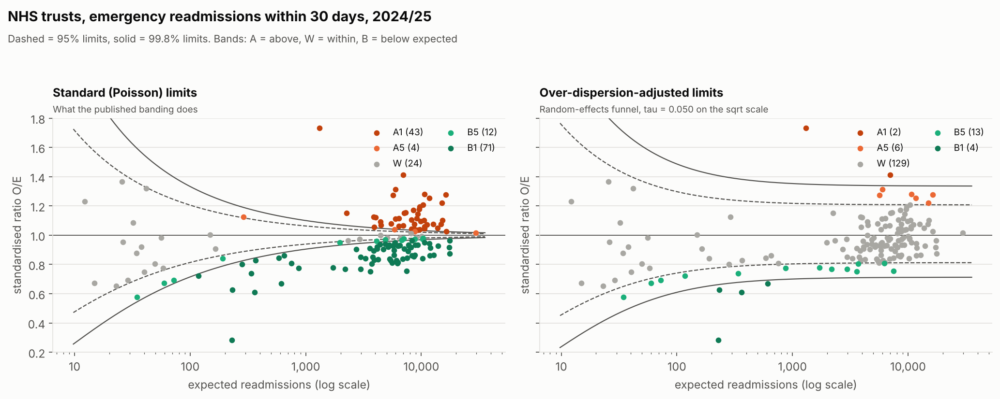
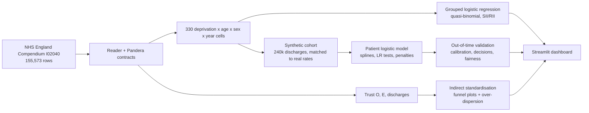

# NHS 30-day Readmissions: Risk Adjustment, Benchmarking & Patient Risk Scoring

[](https://github.com/TilakHeble/nhs-readmission-risk/actions/workflows/ci.yml)

**Which NHS hospital trusts have more emergency readmissions than their patients would predict? Is the gap between deprived and affluent areas closing? And how would a hospital build, validate and use a risk score to decide who gets follow-up after discharge?**

Logistic regression, end to end. The project uses the **real NHS England readmissions data** (64.7 million discharges, 2014/15 to 2024/25) to rebuild and improve the NHS's own benchmarking method, and a transparent **synthetic patient cohort**, anchored to those real rates, to build and validate a patient-level risk model.

- 📊 **Dashboard** (`dashboards/app.py`): trust funnel explorer, inequality trends and a patient risk calculator with a cost-based follow-up decision
- 📄 **[Executive summary](docs/executive_summary.md)** · [Model development document](docs/model_development_document.md) · [Validation report](docs/validation_report.md)
- 🎓 **[learn/](learn/README.md)**: a 10-lesson logistic regression course, from basics to industry practice, built on this project's data

## Headline results

| | Finding |
|---|---|
| 🏥 **Trust benchmarking** | Published NHS banding puts **113 of 154 trusts (73%)** outside 99.8% limits in 2024/25. Over-dispersion is extreme (φ ≈ 63). With SHMI-style random-effects limits, **6** remain. We replicate NHS England's method from the published counts (banding agreement 98.7%). |
| ⚖️ **Inequality** | Most vs least deprived fifth adds **2.4 percentage points** to readmission risk (age/sex adjusted, 2024/25), roughly 156,000 readmissions a year. The Relative Index of Inequality fell from **1.38 to 1.19** since 2014/15, mainly because rates rose faster in affluent areas. |
| 🧮 **Patient model** | Out-of-time AUC **0.672** vs **0.650** for the LACE index and **0.676** for the true probabilities (the ceiling). Calibration slope 0.98. All true effects recovered within their 95% intervals. |
| 💷 **Decisions** | With stated cost assumptions, follow up patients above **30% risk**. Targeting beats a blanket programme by £79 per discharge, but beats doing nothing by only ~£2.50: the case rests on the intervention's effectiveness. |
| 🤝 **Fairness** | Calibrated within every deprivation, age and sex group (O/E 0.99-1.04). Removing deprivation as a predictor doesn't improve fairness: it miscalibrates the least deprived group by 6%. |



## Why this project

- **It is the NHS's own method.** Indirect standardisation, funnel plots and over-dispersion adjustment are how NHS England publishes SHMI and the readmission indicators. Analysts in NHS trusts, ICBs and NHS England do this work every month.
- **It is honest about data.** Patient-level NHS data (HES) are not public. Rather than reuse a popular US dataset, Part 2 simulates patients whose demographic risk structure matches the real NHS data cell for cell, with assumed clinical effects that are documented, so the modelling can be checked against a known truth.
- **It covers the full logistic regression toolkit:** maximum likelihood from scratch, grouped binomial data, over-dispersion and quasi-likelihood, odds ratios vs marginal effects, interactions, splines, likelihood-ratio tests, regularisation, class imbalance, separation, discrimination, calibration, bootstrap optimism, decision curves, cost-based thresholds and fairness.

## How it works



## Notebooks

| # | Notebook | What it shows |
|---|---|---|
| 01 | [The NHS data](notebooks/01_data.ipynb) | What the file contains, suppression and rounding, national trend, age/sex/deprivation patterns |
| 02 | [Grouped logistic regression](notebooks/02_grouped_logistic.ipynb) | IRLS from scratch vs statsmodels, model ladder, over-dispersion, odds ratios vs marginal effects, the narrowing inequality gap |
| 03 | [Trust benchmarking](notebooks/03_funnel_benchmarking.ipynb) | Rebuilding NHS expected counts and banding, funnel plots, Spiegelhalter over-dispersion, shrinkage, rank uncertainty |
| 04 | [Synthetic cohort](notebooks/04_synthetic_cohort.ipynb) | How the cohort is anchored to real NHS rates, the predictability ceiling |
| 05 | [Patient model](notebooks/05_patient_model.ipynb) | Functional form, splines, LR/Wald tests, coefficient recovery, confounding, lasso/ridge, imbalance, separation |
| 06 | [Validation and decisions](notebooks/06_validation_decisions.ipynb) | Out-of-time discrimination and calibration, bootstrap optimism, cost thresholds, decision curves, fairness, hospital funnel |

Notebook sources (percent format) are in `notebooks/src/`.

## Run it

```bash
git clone https://github.com/TilakHeble/nhs-readmission-risk && cd nhs-readmission-risk
make install      # pip install -e ".[dev,dashboard]"
make data         # build processed data from the committed raw CSV (runs the data contracts)
make test         # 35 tests: reader, contracts, IRLS vs statsmodels, funnel, metrics, model, dashboard, every lesson
make notebooks    # execute notebooks 01-06
make dashboard    # streamlit run dashboards/app.py
```

To deploy the dashboard on Streamlit Community Cloud: entry point `dashboards/app.py`, dependencies `dashboards/requirements.txt`.

## Repository layout

```
data/raw/                 NHS England Compendium I02040 CSV (Open Government Licence v3.0)
src/nhsread/
  ingest/                 reader, Pandera data contracts, build script
  models/logit_scratch.py logistic regression from first principles (Newton/IRLS, gradient descent, ridge)
  models/grouped.py       grouped binomial GLM, quasi-binomial inference, marginal effects, SII/RII
  models/patient.py       patient model formulas, out-of-time split, JSON model storage and scoring
  funnel.py               indirect standardisation, Byar intervals, NHS banding, over-dispersed funnels
  synth/simulate.py       synthetic cohort anchored to real NHS cell rates
  evaluation/metrics.py   AUC (DeLong), Brier, calibration, reliability, decision curves, costs, fairness, LACE
models/                   champion, baseline and LACE models as JSON; validation summary
notebooks/                six executed notebooks (+ sources)
dashboards/app.py         Streamlit app
docs/                     executive summary, model development document, validation report, figures
learn/                    logistic regression course
tests/                    pytest suite (CI on every push)
```

## Limitations

- Part 1 is ecological and adjusts only for age and sex (the published file has no diagnosis mix per trust); counts are rounded to 5.
- Part 2 results demonstrate method on synthetic patients; they are **not** evidence of real clinical performance. Any real deployment needs development on patient-level data, external validation and a clinical safety case (DCB0129/DCB0160).
- Costs in the decision analysis are illustrative assumptions.

## Data licence

Contains public sector information licensed under the [Open Government Licence v3.0](https://www.nationalarchives.gov.uk/doc/open-government-licence/version/3/). Source: NHS England, *Compendium: Emergency readmissions to hospital within 30 days of discharge* (I02040).
